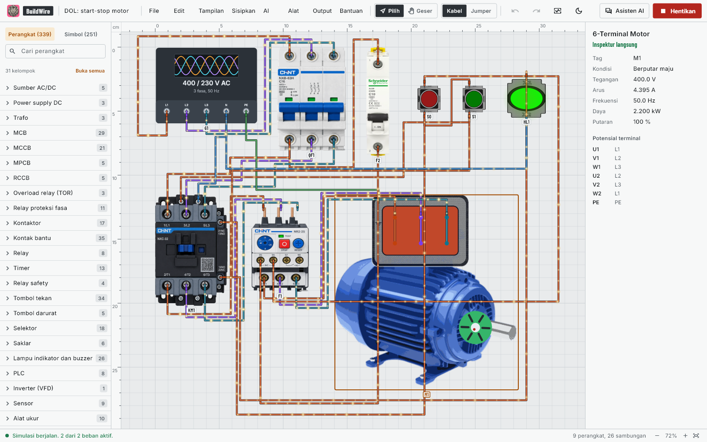
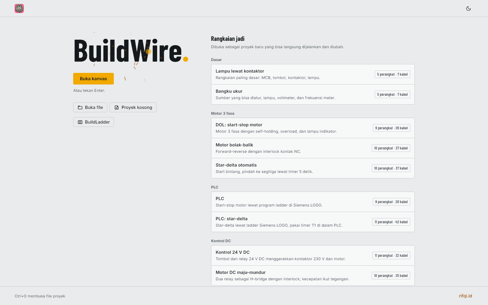
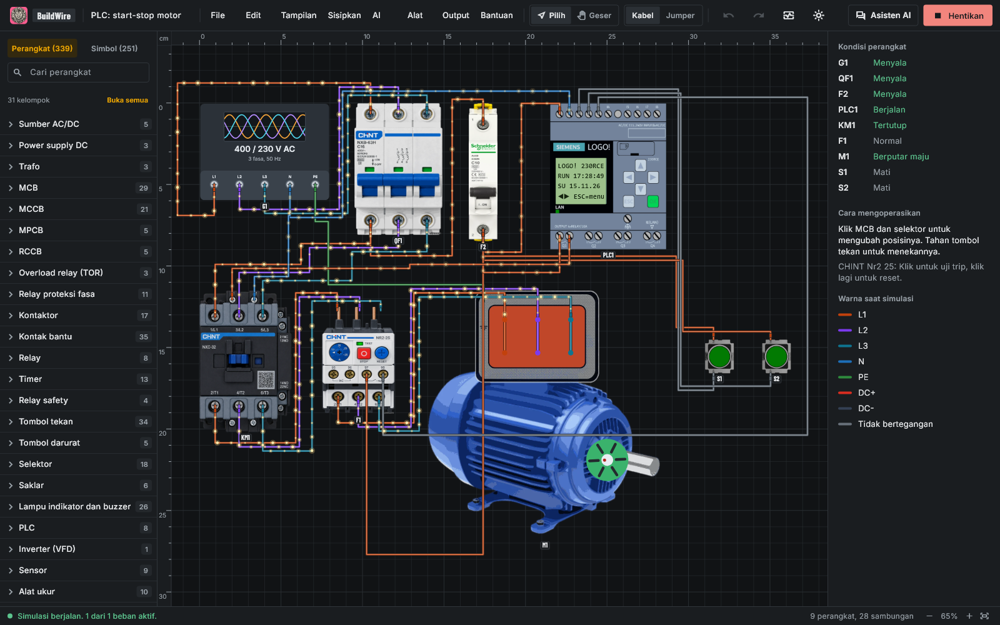
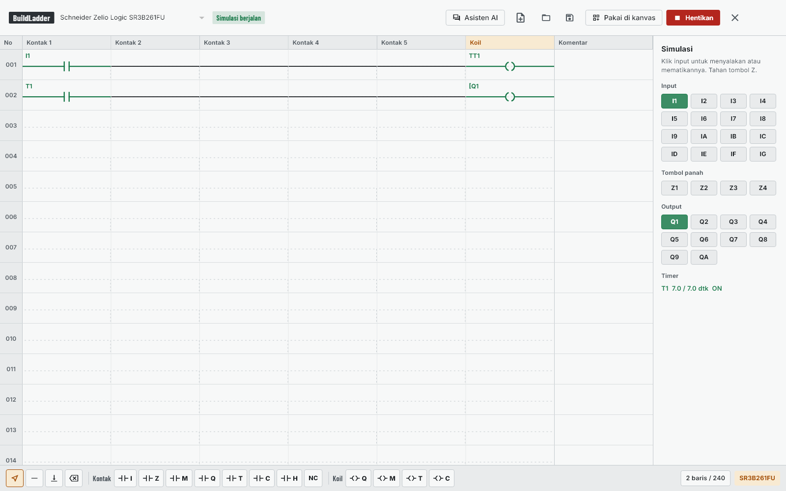
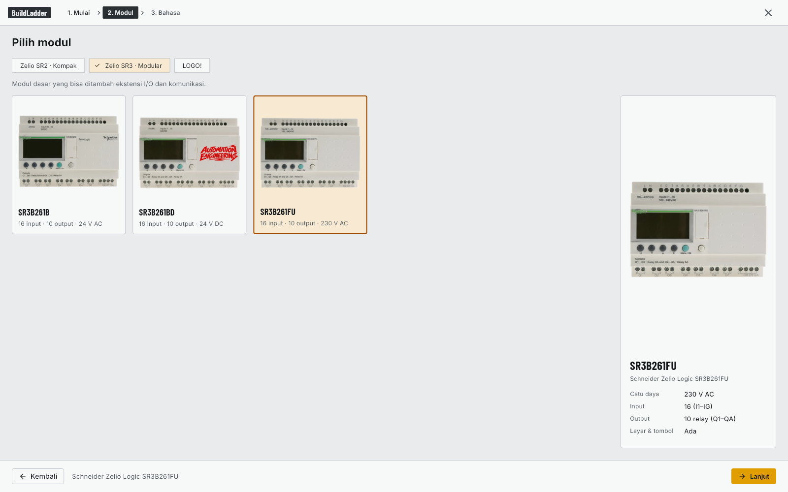

<p align="center"></p>

<h1 align="center">BuildWire</h1>

<p align="center">A Windows app for wiring and simulating electrical control panels and small PLC programs.</p>

<p align="center"><a href="https://github.com/Ripver/buildwire/releases/latest/download/buildwire-setup.exe"><b>Download for Windows</b></a> · <a href="https://github.com/Ripver/buildwire/releases">All releases</a></p>



BuildWire is a practice bench for control wiring. You place breakers, contactors, push buttons, overload relays, motors and PLCs on a canvas, connect them terminal to terminal, and press Run. The circuit then behaves the way it is wired: leave out the hold contact and the motor stops when you let go of the button, wire a short and the breaker trips, forget the interlock and both contactors pull in.

It was made for vocational students and the teachers who train them, so the interface is in Indonesian.

## What it does

**Wiring canvas**
- A library of 339 parts (MCB, MCCB, MPCB, RCCB, contactors, auxiliary blocks, timers, relays, push buttons, selectors, pilot lights, meters, motors, power supplies, DIN rails, enclosures) and 251 schematic symbols.
- Click a terminal and the wire follows the pointer. Left-click on empty canvas to fix a bend, right-click to drop the wire, click the second terminal to finish. Wires without bends are laid by the router: the shortest way around the parts, avoiding crossings and wires on top of each other.
- Every wire carries a printed number marker at both ends. Wires on one potential share a number; wires from the supply take the phase name (L1, L2, L3, N, PE).
- Automatic layout (Alat, Tata letak otomatis) puts the power circuit top to bottom on the left and the controls on the right, ordered so wires drop straight down.
- Parts dropped near a DIN rail clip onto it. A thermal overload relay pushed under a contactor plugs into it, as on a real starter, with no wires between them.
- Parts can be resized from their corner grip or the size slider; terminals and wires follow.
- Ready-made circuits to start from: a lamp through a contactor, a DOL starter, forward and reverse, automatic star-delta, PLC start-stop, PLC star-delta, 24 V DC control, a DC motor H-bridge, and a meter bench.

**Simulation**
- Voltage, current and power for every part, shown on the meters and in an inspector while the circuit runs.
- Breakers trip at once on a short circuit and after a delay on overload. Overload relays heat up and trip, and their TEST, STOP and RESET buttons and current dial work.
- Analog timers turn by dragging or scrolling their knob.
- Three-phase motors run forward or reverse, in star or delta, and stall when a phase is missing.
- Analog and digital meters, pilot lights and buzzers follow the circuit as it changes.

**PLCs**
- Siemens LOGO! 230RCE and 24RCE, and six Schneider Zelio Logic models (SR2B121FU, SR2B121BD, SR2B201FU, SR3B261FU, SR3B261B, SR3B261BD).
- The keypad on each PLC works. Step through the input, output, memory, timer and clock screens, stop and start the program, change timer presets (Set Param), and set the day and time (Set Clock). The clock starts from your computer's time.

**BuildLadder, a ladder editor**
- A Zelio-style grid with five contacts and a coil per row, up to 240 rows.
- Normal, toggle, set and reset coils. Timers in modes A, a, C, B, W, D, PD, T, AC, L and I. Up/down counters. Clock blocks H1 to H8 with weekly on/off schedules.
- Simulates on its own with clickable inputs, or runs inside a PLC on the canvas.
- Opens and saves Zelio Soft 2 `.zm2` files, so a program written here loads in Zelio Soft and the other way round.

**BuildRelay, a relay control schematic editor**
- Draw classic relay control on a blank sheet with IEC symbols, the control and the power circuit together. There are no ready-made circuits; every diagram starts empty.
- Supplies (single phases, three-phase with or without N, DC, a 24 V DC power supply, a control transformer), push buttons, emergency stops, selectors including 1-0-2, limit switches, contactor and relay coils, impulse relays, on-delay, off-delay and flasher timers, NO, NC and changeover contacts, fuses, MCBs, MPCBs, RCDs, isolators, overload relays, lamps, buzzers, bells, sirens, heaters, solenoid valves, and single-phase, three-phase, star-delta, Dahlander and DC motors.
- Wires go point to point: click a terminal, click to bend, click the target terminal, or click the middle of a wire to branch from it.
- Contacts follow the coil, timer or overload relay with the same tag (KM1, KT1, F1).
- Press Simulasi and operate the sheet: buttons act while held, selectors and emergency stops stay where they are put, breakers switch off and trip. Live wires take the colour of their phase, coils and lamps light, motors turn and show forward or reverse, star or delta. A short trips the breaker feeding it, and an earth fault trips the RCD.
- Diagrams save as `.bwrelay` files.

**AI assistant (optional)**
- Works with your own API key on any Anthropic-compatible or OpenAI-compatible endpoint (Claude, GPT, DeepSeek and others). The key stays on your computer, encrypted with Windows DPAPI.
- It places parts, draws the wires and writes ladder programs, then runs the simulator to check the result before it reports back.
- Attach a photo or drawing of a panel, a wiring diagram or a ladder program and ask it to copy it. Reading pictures needs a model that accepts images.

## Screenshots

| | |
|---|---|
|  |  |
| Home screen with the ready-made circuits | A LOGO! running a start-stop program, dark theme |
|  |  |
| BuildLadder simulating an on-delay timer opened from a `.zm2` file | Choosing a PLC module for a new ladder program |

## Install

1. Download [`buildwire-setup.exe`](https://github.com/Ripver/buildwire/releases/latest/download/buildwire-setup.exe) (Windows 10 or 11, 64-bit).
2. Run it. It installs for your Windows account only and does not ask for administrator rights.
3. The installer is not code-signed yet, so SmartScreen may say "Windows protected your PC". Click **More info**, then **Run anyway**.

Installing a newer version over an older one keeps your settings. When you uninstall, you are asked whether to delete the settings and the stored API key too.

## Limits

Use it for training, not for designing real installations.

- The solver finds the steady state with fixed load impedances. It does not calculate voltage drop, does not share current between parallel paths, and does not model waveforms or transients.
- Trip times come from a simple thermal model, not from manufacturer curves. Device ratings are sample values.
- Clock blocks and row comments are not read from or written to `.zm2` files yet. The rest of a Zelio ladder program is.
- The interface is Indonesian only, and only the Windows build is maintained.

## Building from source

You need Flutter 3.47 (stable channel) and Visual Studio 2022 with the "Desktop development with C++" workload.

```text
flutter pub get
flutter test
flutter build windows --release
```

The app ends up in `build\windows\x64\runner\Release`. To build the installer, install [Inno Setup 6](https://jrsoftware.org/isinfo.php) and run

```text
ISCC installer\buildwire.iss
```

which writes `dist\buildwire-setup.exe`.

### Where things are

| Path | Contents |
|---|---|
| `lib/sim/solver.dart` | The circuit solver: nets, sources, loads, breakers, motors |
| `lib/sim/ladder.dart` | Ladder program model and scan: coils, timers, counters, clock blocks |
| `lib/sim/zm2.dart` | Reading and writing Zelio Soft 2 `.zm2` files |
| `lib/ui/` | Canvas, panels, BuildLadder, home screen, theme |
| `lib/relay/` | BuildRelay: symbols, simulation and editor |
| `lib/ai/` | The assistant: endpoint detection, agent loop, canvas and ladder tools, attachments |
| `assets/devices/` | Part pictures and `index.json`, the part catalogue |
| `assets/symbols/` | Schematic symbols converted to SVG |
| `tools/` | Scripts that build the catalogue, sounds and meter faces |
| `installer/` | Inno Setup script |

## License

The code and BuildWire's own artwork are released under the [MIT License](LICENSE).

Some parts come from others and keep their own licenses:

- Schematic symbols are converted from [QElectroTech elements](https://github.com/qelectrotech/qelectrotech-elements), licensed [CC BY 3.0](https://creativecommons.org/licenses/by/3.0/).
- The fonts [Inter](https://rsms.me/inter/) and [Barlow Condensed](https://github.com/jpt/barlow) are licensed under the SIL Open Font License 1.1 (see `assets/fonts`).
- Flutter and the Dart packages listed in `pubspec.yaml` are under their own licenses.

Product names and logos shown on parts (Schneider Electric, Zelio, Siemens, LOGO!, CHINT and others) belong to their owners. BuildWire is not affiliated with or endorsed by any of them.
